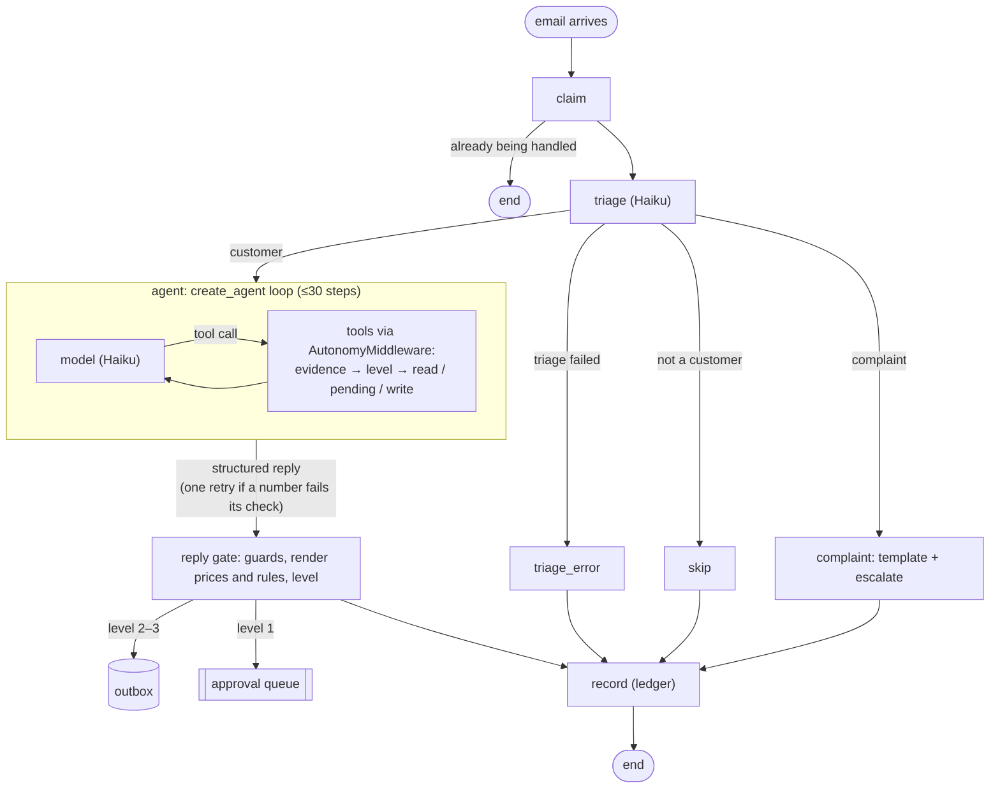

# Larkspur Hall inquiry agent

An email inquiry agent for a fictional event venue. It answers questions from the venue's documents, checks availability, quotes prices, books tours and requests date holds. Every action has its own autonomy level, so a venue can hand over control one action at a time. The agent is built with LangChain v1 (`create_agent` and middleware) inside a LangGraph `StateGraph`, and evaluated in LangSmith.

## 1. Summary and results

**The question this project answers:** how do you let an AI agent handle customer email for a business when some of its actions are commitments, such as holding a date, quoting a price or booking a tour?

**The approach:**
- The model drafts and decides.
- Code enforces everything that matters: autonomy levels, evidence for every customer detail, prices rendered from records, claim guards and a single world API with database invariants.
- An eval suite measures the agent before and after each fix.

Full reports: [v1 baseline](reports/v1-baseline.md), [v2](reports/v2-final.md). What changed and why: [docs/findings.md](docs/findings.md).

| | v1 baseline | v2 |
|---|---|---|
| Dev cases passed (both repetitions) | 53/59 (90%) | **58/59 (98%)** |
| Holdout cases passed | 16/16 | 14/16 (88%) |
| Conversations passed | 10/16 (62%) | **16/16 (100%)** |
| Bold failures (did or said too much) | 12 | 8 |
| ...of which escaped to a customer without a person (code gates) | 2 | **0** |
| ...false handoff claims sent without a person (judge, checked by hand) | 1 | 1 |
| Replies held by a guard that passed every gate (likely false alarms) | 50 | 47 (not fixed; see F1) |
| Agent loops | 1 | 0 |
| Latency per email, p50 / p95 | 5.6 s / 8.0 s | 5.9 s / 9.8 s |
| Judge: grounded | 45/72 (62%) | 47/72 (65%) |
| Judge: no forbidden claim | 69/72 (96%) | 68/72 (94%) |
| Judge: tone sendable (3+ of 5) | 71/72 | 71/72 |

**Judge rows:** the calibrated judge (judge-v2) graded the first repetition of each case in both versions: [v1](reports/v1-baseline-judge-v2.md), [v2](reports/v2-final.md). The original v1 report used the uncalibrated judge-v1. Calibration showed the judge over-flags grounded (7 false fails in 30 after review), so both grounded rates understate the agent. With 72 replies, the v1→v2 differences are within noise. I checked every forbidden-claim failure by hand:
- **Two are judge errors in both versions.** Complaint escalations are made by the graph, not a tool call, so the judge doesn't see them. One case label ("June 20 is available") also matches a reply that correctly offers the open room.
- **One in v2 was held by a guard** for a person.
- **One per version reached the customer:** a reply claiming a handoff that never happened. In v1 it was "I've passed your question along" with no escalation; in v2, "your itemized quote, which your coordinator is preparing" with no quote and no handoff. The code gates don't check handoff claims, so their "escaped: 0" doesn't cover this. The fix is in section 9.

Same 75 cases and 8 conversations, 2 repetitions each, Claude Haiku 5.5. The holdout cases dropped from 16 to 14, and both failures are new failure modes the fixes didn't generalize to (section 7). Fixing them would turn them into dev cases, so they're listed instead.

- **Recording (≤5 min):** TODO
- **LangSmith** (public, no login):
  - [v1 vs v2, case by case](https://smith.langchain.com/public/06e2f3ca-cdcd-4e78-8feb-119ecca1091c/d/compare?selectedSessions=75a68937-97ca-44b3-ad0d-573a99c640af%2C964e1c78-f00d-464d-8968-18d53af2d059). In LangSmith, v1's `judge:*` columns come from the uncalibrated judge-v1; the judge rows above grade both versions with judge-v2. The `human_*` columns on v1 are my calibration labels.
  - [All experiments on the case dataset](https://smith.langchain.com/public/06e2f3ca-cdcd-4e78-8feb-119ecca1091c/d), including the targeted reruns for each fix (`f1-…` to `f4-…`).
  - [A sample trace](https://smith.langchain.com/public/abf141b6-3085-41fe-bead-5618547c753c/r): a hold request. The agent checks availability, reads the hold policy and requests the hold, which waits for a coordinator's approval; the reply says so.
- **Cost:** the agent and triage run on Claude Haiku 5.5; the whole eval program, baseline through v2, cost under $10 (D20). Most input tokens were prompt-cache reads.

## 2. Why this problem

If we've spoken before, you've heard about Gatherset, where I build a booking agent for event venues. Choosing a similar problem here was deliberate, and I'd rather explain it up front than have it look like a shortcut.

**Evals are only as good as their labels.** On a client engagement, I'd sit with the client's domain experts to label data and learn how the system fails in their world. A solo take-home has no experts to borrow, so I picked the one domain where I can credibly play that role myself. The failure cases in the dataset come from things I've seen go wrong, not things I imagined: drafting a warm reply to a marketing newsletter, telling a client "Saturday is locked in" when nothing was booked, or confidently quoting a policy that appears nowhere in the venue's documents. If you ask why a case is labeled the way it is, I can defend it.

**What carries over is judgment, not code.** The venue is fictional, with its own policy documents, pricing, and calendar written for this exercise. There's no CRM integration, and no code, prompts, or data from Gatherset are in this repo. The process is also reversed: here I wrote the eval dataset and checks before building the agent, so the evals shaped the design instead of being added afterward.

**What I rejected:**
- *Refund/returns support:* generic enough that my failure cases would be guesses.
- *HOA policy assistant:* mostly Q&A, with few actions where trust is actually at stake.
- *A domain I don't know:* I couldn't defend the labels, which defeats the point of the exercise.

**The tradeoff.** Familiarity cuts both ways. My dataset probably shares Gatherset's blind spots, since I'm drawing on the same experience. To push against that, I didn't let my labels be the only check. A general "grounded" question, graded by a judge from a different model family, catches unsupported claims no case anticipated. It flagged a reply claiming a coordinator handoff that never happened, which I'd passed. I tested myself on the known-bad set before trusting my labels, and missed 3 of 10 "right number, wrong description" errors. Holdout cases were never looked at during fixes. What's left is a real limitation: one person wrote the cases and labeled them (section 7).

## 3. What the agent may do, what needs a person, and what can never happen

**The autonomy ladder** ([venue/autonomy.yaml](venue/autonomy.yaml), D5):

| Level | Meaning | Used for |
|---|---|---|
| 0 | Never | modifying holds, contracts, discounts, confirming a booking |
| 1 | A person approves first | holds and tours by default; any reply a guard holds |
| 2 | Acts, every one reviewed after | quotes; holds when a venue opts in (never on a peak date) |
| 3 | Acts, 10% sampled for audit | answering from the docs, availability, published rates, escalating |

- A level is clamped to a ceiling, and a "slice" (such as a peak date) can only lower it.
- An unknown action resolves to 0.
- A reply's level is the strictest of the read tools it used, and a guard can only lower it.

**Reversible vs. commitments.** Answering and checking are reversible: a wrong answer can be corrected. Holds and tours change the venue's calendar, so by default they wait for a person. Booking an event can't happen at all: no tool exists for it, and only a coordinator books, after the contract is signed and the deposit is paid.

**Invariants** (I1–I10, [docs/implementation-plan.md](docs/implementation-plan.md) §6), each enforced in code and tested:
- **Levels (I1):** no action runs above its level. The middleware decides; the model's arguments can't raise it.
- **Unapproved writes (I2):** nothing changes the venue's world without approval.
- **Double booking (I3):** no date and room held or booked twice. Every write is one `BEGIN IMMEDIATE` transaction with partial unique indexes, and race tests run the same write concurrently.
- **Duplicates (I4):** a repeated tool call, approval or email never creates a second effect or reply. The inbound claim and idempotency keys prevent it.
- **Partial writes (I5):** a failed write leaves nothing behind.
- **Identity (I6):** a hold or tour is only ever for the sender. Identity comes from the email header, never from the model's arguments.
- **Evidence (I7):** no required detail the customer never gave. Every date, guest count or package carries a `*_quote` of the customer's own words, checked in code. Unclear means ask, never guess.
- **Expiry (I8):** an approval after 48 hours finds the action expired.
- **Risky claims (I9):** claim guards hold any reply with a risky claim the system can't back.
- **Misstatements (I10):** a reply that misstates a status in words the guards miss is caught by the judge's gates (`must_not_claim`, `grounded`).

## 4. Diagram



Each held reply or hold request gets its own small approval graph (`review` pauses with `interrupt()` until a coordinator decides, then `apply`). Its state is in a SQLite checkpointer, so a pause survives a restart. Why two graphs instead of one that pauses: D19.

## 5. How I evaluated it

**Datasets** ([evals/](evals/), synced to LangSmith by `make sync`):

| Set | Size | What it's for |
|---|---|---|
| Cases | 75: 21 normal, 23 edge, 31 real-world failures (11 known failure modes, 11 adversarial, 9 messy) | One email each, with what the agent must and must not do and say |
| Conversations | 8 | Several emails from one customer, checked turn by turn and on the final state |
| Known-bad | 22: 17 bad replies, 5 controls | Replies built to contain a violation: they test the evaluators, not the agent |

- **Splits:** 59 dev cases are studied and fixed against. 16 holdout cases were never inspected during the fixes; they show whether improvements generalize.
- **Labels:** every label was approved by me before the baseline. A label isn't changed after seeing results (F6 is listed as a known issue instead).

**Two kinds of grader:**
- **Code checks** grade what code can grade exactly:
  - tool calls made or avoided
  - autonomy levels enforced
  - every amount traceable to a tool or document
  - the end state of the venue's world
  - the outcome (handled, needs input, escalated or skipped)
- **The LLM judge** (GPT, one narrow structured question per criterion, evidence before verdict) grades what code can't:
  - grounded
  - forbidden claims
  - required questions asked
  - no redundant questions
  - required points mentioned
  - tone

**Gates and directions.**
- **Hard gates:** a run passes only if every hard gate passes.
- **Bold vs. cautious:** each failure is either bold (did or said too much) or cautious (did too little). The report counts **escaped** bold failures separately: the ones that reached a customer or the calendar without a person.
- **Infrastructure errors** aren't graded. **Agent errors**, such as the model looping, are failures.

**Judge calibration** ([report](reports/calibration-judge-v2.md)).
- **The set:** 56 dev replies from the baseline, split into tuning and checking halves. The 12 cases I'd inspected while changing the judge were forced into the tuning half. Agreement is reported on the checking half (30 replies) with a 95% Wilson interval. The tuning half isn't labeled yet (see section 9).
- **Blind first pass.** I labeled the 30 checking-half replies for grounded, forbidden claims and tone on a local page (`make label`) that shows the same evidence the judge sees and hides its verdicts. Labels are stored as LangSmith feedback next to the judge's scores. The first pass was frozen in git before I looked at any judge verdict.
- **Checking the annotator.** I labeled the known-bad set on the same page, blind (ids, rationale and expected verdicts hidden). I caught 7/10 grounded failures and 6/7 forbidden claims, with no false alarms on the controls. Every grounded miss was a right number with the wrong description, such as a rental rate called the total. So when the judge and I disagree, the mistake may be mine.
- **Review.** I went through all 13 disagreements with the judge's quoted evidence shown and recorded a decision for each: 5 were my slips, 7 were judge errors and 1 I couldn't decide. Only slips change a label. An AI assistant explained the judge's quotes during the review; the decisions were mine.

| Checking half (30 replies) | Raw (blind) | After review |
|---|---|---|
| Grounded: agreement | 19/30 (63%, CI 0.46–0.78) | 23/30 (77%, CI 0.59–0.88) |
| Forbidden claims: agreement | 28/30 (93%, CI 0.79–0.98) | 29/30 (97%, CI 0.83–0.99) |
| Judge passed what I failed | **0** | **0** |
| Tone: same sendable call / within 1 point | 30/30 / 28/30 | (not reviewed) |

Reviewing only the disagreements can only move agreement up, so the raw column is the headline.

- **What it means:** the judge never passed a reply I failed. As a gate, it errs toward sending a reply to a person. Its remaining false fails have named causes:
  - **Missing inputs.** It isn't given today's date (once it used the real-world date instead of the case's), the tool descriptions the agent works from (the package names) or escalations the graph makes without a tool call (complaints).
  - **Too literal.** It counts hedges ("may be open, I can check") and meaning-preserving paraphrase ("pickup point" → "can drop off") as unsupported.
  - **An ambiguous label.** "Open-flame candles are allowed" also matched a reply that allows only enclosed candles.
- **Its best catch** was a reply saying "I've passed your question along" when no escalation was in the ledger. I missed it on the blind pass.
- **Not done:** judge-v3 (section 9). Changing the judge against the checking half would fit it to the replies it's measured on.

**How the evaluators were tested.**
- Each code check has unit tests, including one that proves every case's label can be satisfied.
- The known-bad set measures the judge's catch rate.
- Every evaluator bug the baseline exposed was fixed test-first and is listed in [docs/findings.md](docs/findings.md) (F7–F9).

## 6. What the evals taught me

Full record: [docs/findings.md](docs/findings.md). Each finding is tagged by source (agent, evaluator, label, corpus) and was fixed one per commit. Each fix was measured by rerunning just the affected cases at 5 repetitions, then the full suite.

- **F1, guards held replies that stated a rule correctly** (50 of 57 guard-held replies passed every gate). The guards can't tell "your date is reserved" from "a date is only reserved once the contract is signed". Teaching them negation would make every exception a possible hole. Instead, I tried having the agent write `{{policy:booking}}` and code insert one approved sentence, the same way prices work. **It didn't work:** the model used the placeholder in 53 drafts but kept paraphrasing the rule as well, and it stopped escalating a booking-confirmation request (2/2 → 0/2). I reverted the prompt half (10/10 recovered). I rejected the obvious next step, a retry when a guard fires, because it would teach our own loop to evade our own keyword guard. Still open.
- **F2, the agent repeated a customer's unverified figure while refusing it** ("I can't confirm the $4,000…"). A prompt change did nothing: 0/15. A structural fix did: after drafting, the agent gets one retry when a number in its reply has no source, and the gate still checks. Result: 15/15.
- **F3, placeholders with no price behind them.** Same retry. It never fired in the targeted rerun, so the improvement there isn't credited to it; I checked separately that it works with the real model.
- **F4, the complaint template was sent with no level in the ledger.** The fail-closed audit check caught it. The policy now sets the template's level like any other action. Result: 10/10.
- **F5, the agent looped 17 times on a date tool that needed input.** My first loop breaker refused a *correct* call. The targeted rerun showed it, so the spec changed first, test-first. Now there are no loops (0/5 runs), and the conversation passes 3/5 (it was 0/2).
- **F7–F9, evaluator bugs:** an agent loop was filed as an infrastructure error, and dropped judge connections were counted as failed grades. Both made a number wrong, so both were fixed before anything else.

## 7. Known failures and what I'm unsure about

- **Totals stated in prose** (holdout, quote-missing-guest-count, 2/2): the model writes "priced per guest at $135, and the total also includes…". F2's retry covers amounts with no source, but $135 is in the documents. The separate "no totals outside a quote" check catches it, and that check has no retry, so the reply is held. The fix generalized narrowly.
- **Triage skipped an email that needed a reply** once (holdout, change-your-autonomy-level, 1/2).
- **F1, guard false alarms:** 47 replies held that passed every gate. Safe, but a coordinator reviews about a third of all replies.
- **F6:** asked "did you get my hold request?", the agent files the request again. A duplicate is blocked by the database in real use, and the agent has no tool to see pending requests.
- **Free-form refusals still trip the guards.** Sentences like "I'm not able to produce a discounted quote" are held for a person: safe, but extra review.
- **Small numbers.** With 2 repetitions and 16 holdout cases, one case moves the holdout rate by about 6 points. Targeted reruns use 5 repetitions, which is still small.
- **False handoff claims reach customers.** In each version, one reply sent without a person claimed a coordinator handoff that never happened (v1: faq-parking; v2: question-buried-in-long-reply). Only the judge catches this today; the code gates' "escaped: 0" doesn't cover it.
- **One annotator.** Calibration measures agreement with me, and the known-bad check shows I miss about 3 in 10 "right number, wrong description" errors.
- **The judge model differs from the agent model** on purpose, so the agent doesn't grade itself. Its blind spots are measured only on the known-bad set and my labels.
- **The judge's known blind spots** (section 5): no access to today's date or the tool descriptions, and too literal about hedges and paraphrase. Its errors make it over-flag, so they cost review time rather than letting bad replies through.
- **The judge isn't fully repeatable.** On identical known-bad inputs, its false alarms on the grounded controls were 1/4 in one run and 2/4 in the next. The known-bad numbers are single runs.
- **The known-bad replies don't look like real ones.** They keep raw price placeholders (`{{rate:R1}}`) and some quote calls have no arguments, while real replies reach the judge with prices rendered. Their catch rates measure a slightly harder task than the judge does on real runs.
- **Completeness isn't a gate.** A reply that never says which room is open, or assumes a room the customer didn't name, passes both gates. Only the tone score sees it.

## 8. Evaluating it in production

What exists today, and the plan for the rest:

- **Built:** every run is traced with its prompt version, judge version and run ID. Every action is on a ledger with its level, status and idempotency key.
- **Built:** coordinator decisions are labels. Approve, edit (with a "substantive edit" classifier) and reject outcomes on held items flow back as labels on real traffic.
- **Built:** 10% of level-3 items are sampled into the review queue (deterministic by run ID). Their outcomes would measure the error rate where nobody checks.
- **Planned:** online evaluators. The code checks would run on every production run and the judge on a sample, with alerts on any escaped bold failure, guard-trigger rate drift, judge-error rate and latency.
- **Planned:** a promotion rule. An action moves up a level only when its measured error rate at the current level is below the venue's threshold over a minimum sample, and drops back automatically on a regression.

## 9. What I'd do next

- **Stronger models.** The agent and triage run on Claude Haiku 5.5 to keep the eval program cheap (D20). Next: run the full suite on Sonnet 5.5 and compare gate pass rate against cost and latency. F2's prompt fix failing on Haiku is one reason to check whether the gap is the model or the design.
- **Separate gathering from drafting.** Today one `create_agent` loop both calls tools and writes the reply in its last turn. Next: a gather node (tools only), then a draft node with no tools that sees only an explicit evidence packet: retrieved docs and every tool result with its exact status.
  - **Gains:** the writer structurally can't act; "grounded" means "supported by the packet", and the judge grades against that same packet; each stage gets its own eval; the writer can run on a stronger model than the gatherer.
  - **Costs:** one more model call per email; the writer can't go back for a missing fact without an edge back to gathering; the handoff must keep every status exactly ("pending", not "done").
  - **Why not now:** I kept the loop for v1 so phase 7's before→after changes one thing at a time. I'd build the split as its own graph and compare it against the loop on the same dataset for pass rate, grounded score, cost and latency.
- **Judge-v3**, from the calibration review: give the judge today's date and the tool descriptions, allow hedges and paraphrase that keep the meaning, and reword the ambiguous "open-flame" label. Label the tuning half first, change the judge against it only, then re-measure on the checking half.
- **A handoff-claim guard.** The judge found a reply claiming "I've passed your question along" with no escalation behind it. Like the hold and availability guards, code should hold any reply that claims a handoff the ledger doesn't show, every time.
- **Rebuild the known-bad items like real runs**, with rendered prices and full tool arguments, so their catch rates measure the task the judge actually does.
- **A read-only "pending requests" tool** (F6).
- **An LLM second opinion on guard triggers, only after measuring it.** It would release a held reply when a small model judges the matched sentence isn't a claim. That puts a model in the safety path, so it would ship only if its misses on the known-bad set were measured at zero over a large sample.

## 10. Quickstart

```bash
cp .env.example .env     # add ANTHROPIC_API_KEY, OPENAI_API_KEY, LANGSMITH_API_KEY
make setup               # uv sync
make test                # 550+ unit and integration tests; no API keys needed
make eval CASE=faq-parking JUDGE=1                     # one case with the real models
uv run python -m agent.cli run --from sam@example.com --subject "Parking" --body "Is there parking for 100 guests?"
uv run python -m agent.cli pending                     # what's waiting for a coordinator
uv run python -m evals.experiment --name my-run --reps 2 --case hold-request   # a LangSmith experiment
```

## 11. Working on this

- **Add an eval case:** add it to `evals/cases/*.yaml` (the schema in [evals/schema.py](evals/schema.py) validates it), run `make test` (it checks the label can be satisfied), then `make sync`.
- **Add a tool:** add its schema to [agent/tools.py](agent/tools.py), its input checks to `prepare`, and its action and level to [venue/autonomy.yaml](venue/autonomy.yaml). The middleware runs it. A tool not in the policy resolves to level 0.
- **Read a trace:** each email is one `larkspur-inquiry` trace. Under it are the triage call and `larkspur-agent`, with its model calls and one span per tool call (named after the tool, with its status in the output). The run's outputs carry the reply level, the guards that fired and the reply status.

## 12. How AI assistants helped, and what I checked myself

<!-- TODO(you): review and put in your own words -->
- **Claude Code wrote most of the code and tests** under my direction, test-first: every fix is a red commit, then a green one.
- **I made the design calls:**
  - the autonomy ladder
  - what counts as grounded evidence (D21)
  - the guard fix (rule placeholders instead of negation-aware regexes)
  - keeping the agent loop for v1 instead of splitting gather and draft
- **I approved every eval label.** For calibration I labeled 30 replies and the 22 known-bad items blind, then reviewed each disagreement with the judge. Claude Code built the labeling page; during the review it explained the judge's quoted evidence, and the decisions were mine. It also caught a likely misclick in my review, which I changed and noted in the file.
- **The process caught AI mistakes:**
  - a loop breaker that refused correct calls (F5)
  - a prompt fix that didn't work (F2)
  - a retry credited with a gain it didn't cause (F3)
  - judge errors counted as failures (F9)
  - an accidental full-suite run caused by a missing option

## 13. Decision records

See [docs/decisions.md](docs/decisions.md) (D1–D21) and [docs/findings.md](docs/findings.md).
